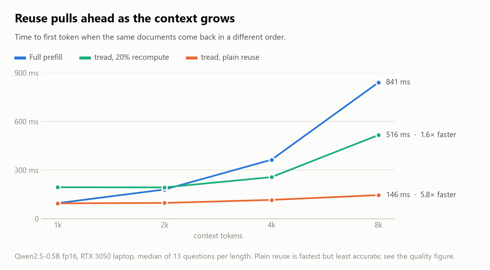
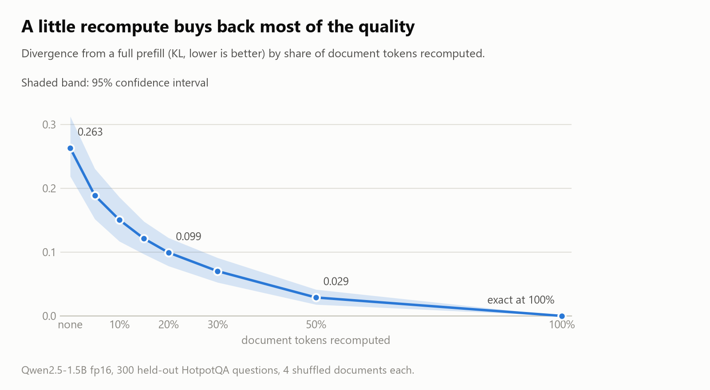
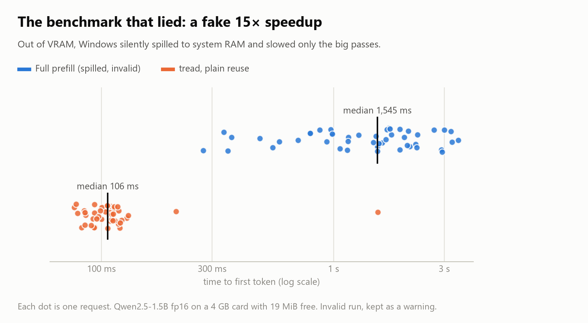

# tread

Position-independent KV-cache reuse for LLM inference. Reuse the KV cache of a text chunk
(a RAG document, a tool output) wherever it appears in a prompt, not only when it is part of an
exact token prefix.

Today's serving engines (vLLM, SGLang, llama.cpp) reuse KV only on exact prefix matches. If the
same documents come back in a different order or mix, everything after the first change is
recomputed. tread caches each chunk as a content-addressed block, shifts it to its new position
with an exact RoPE rotation, and optionally recomputes a small, selected subset of tokens to repair
the cross-chunk attention that independent caching misses.

Status: working engine, HTTP server, tests, and a laptop-scale benchmark. Large-model timings and the
vLLM / llama.cpp comparison are **not yet run** (scripts in `bench/cloud/`, untested).
See [docs/REPORT.md](docs/REPORT.md) (technical report, draft), [docs/BLOG.md](docs/BLOG.md) (blog draft),
[SCOPE.md](SCOPE.md) (original plan), [phase0/RESULTS.md](phase0/RESULTS.md) and
[bench/RESULTS.md](bench/RESULTS.md) (raw results, including invalid runs).

## At a glance

**Skipping the prefill gets more valuable the longer the context.** When the same documents return in a
different order, plain reuse answers in about the same time at 1k tokens and 5.8x faster at 8k.

<picture>
  <source media="(prefers-color-scheme: dark)" srcset="docs/img/latency-dark.png">
  
</picture>

**But reuse is not free.** A chunk cached on its own never saw the chunks before it, so the output drifts
from a full prefill. Recomputing a selected 20% of document tokens removes about 60% of that drift, and
100% reproduces full prefill exactly. That trade-off is the whole project.

<picture>
  <source media="(prefers-color-scheme: dark)" srcset="docs/img/quality-dark.png">
  
</picture>

Both figures are small-model, laptop-GPU results, and they come from different models and context lengths,
so they do not combine into one speed-for-quality number. Regenerate them with `bench/plot_readme.py`.

## How it works

```
request = [system prompt][doc 1]...[doc N][query]      (sent as separate segments)

system prompt ──► exact-prefix block (cached)
each doc ──────► block keyed by hash(model, dtype, RoPE cfg, system prompt, doc tokens)
                  miss: prefill doc on top of the cached system prompt, store at base position P
                  hit:  rotate cached keys by (new offset − P); values need no change
optional ──────► selective recompute of a fraction of doc tokens (deviation-guided)
query ─────────► normal forward over the assembled cache → first token
```

- **Exact positional correction.** RoPE is a rotation, so keys cached at position *p* are moved
  to *p′* by rotating them by *p′ − p*. Tested to match in-place computation.
- **Shared-prefix chunk prefill.** Docs are cached after the system prompt rather than alone.
  This halves the reuse error (attention-sink effect; Phase 0).
- **Selective recompute.** Picks the tokens whose layer-1 KV drifts most from a fresh pass, and
  recomputes them through every layer against the reused cache (CacheBlend-style).
- **Block store.** Content-addressed, GPU byte budget with LRU, spilling to a pinned-CPU tier; per-tenant namespaces.
- **Cold path.** Missed documents are prefilled together in one packed forward (block-diagonal mask).
- **Optional CUDA graphs** for the recompute loop at contexts of 2k tokens or less.

## Layout

| path | what |
|---|---|
| `tread/blend.py` | RoPE re-rotation, chunk prefill, selective recompute |
| `tread/store.py` | content-addressed block store: GPU + pinned-CPU tiers, budgets, LRU |
| `tread/engine.py` | request assembly, plus full-prefill and exact-prefix baselines |
| `tread/graphs.py` | CUDA-graph replay of the recompute layer loop |
| `tread/server.py` | FastAPI server: `POST /v1/completions` (segments), `GET /metrics` |
| `tests/` | correctness tests (exactness, cache hits, eviction) |
| `bench/bench_ttft.py`, `bench_scaling.py` | TTFT / quality benchmarks on a reordered-RAG workload (k docs, 1k-16k tokens) |
| `bench/workload.py` | the shared workload generator (all systems see identical tokens) |
| `bench/baselines.py`, `bench/cloud/` | vLLM / llama.cpp baselines + one-command GPU run (untested) |
| `bench/plot_readme.py` | renders the figures in this README from the committed result files |
| `docs/` | technical report, blog draft, and `img/` (README figures) |
| `phase0/` | feasibility study: quality vs recompute, predictor and held-out experiments |

## Setup

Python 3.11, CUDA GPU (developed on an RTX 3050 laptop, 4 GB).

```bash
python -m venv .venv
```

```bash
.venv/Scripts/python -m pip install torch==2.5.1 --index-url https://download.pytorch.org/whl/cu121
```

```bash
.venv/Scripts/python -m pip install transformers==4.46.3 accelerate==1.1.1 datasets==3.1.0 matplotlib pytest
```

`transformers` is pinned: the engine patches into Qwen2 attention internals that change between versions.

## Run

```bash
.venv/Scripts/python -m pytest tests -q
```

```bash
.venv/Scripts/python bench/bench_scaling.py --model Qwen/Qwen2.5-0.5B-Instruct --lengths 1000 2000 4000 8000 --n 15
```

Serve it (binds to localhost; no auth, see the trust model in `tread/server.py`):

```bash
.venv/Scripts/python -m tread.server --model Qwen/Qwen2.5-0.5B-Instruct --port 8000
```

```bash
curl -s localhost:8000/v1/completions -H 'content-type: application/json' -d @docs/example_request.json
```

Send the same documents in the opposite order and every block is reused (`block_misses: 0`). On this tiny
example (2 documents, 0.5B model) plain reuse (`"recompute_ratio": 0`) answers "Japan" and 20% recompute
answers "Tokyo", which matches a full prefill. That is one illustration, not evidence: measured rates are in
[docs/REPORT.md](docs/REPORT.md). The server decodes with plain greedy (no sampling, no repetition penalty), so its
output matches a raw full-prefill argmax, not `model.generate()` with Qwen's default `repetition_penalty=1.1`.

`bench_ttft.py` (fixed 8-document workload) is the older benchmark; its 1.5B results are invalid on a 4 GB card.

## Findings so far (Qwen2.5, HotpotQA)

- 100% recompute reproduces full prefill exactly, and the RoPE shift is exact. Reuse is a
  quality/compute trade-off, not a correctness bug.
- On 300 held-out examples (1.5B, fp16), KL vs full prefill drops from 0.263 (plain reuse) to
  0.099 / 0.070 / 0.029 at 20 / 30 / 50% recompute.
- Error is heavy-tailed: the worst 10% of requests carry about half of it.
- Adaptive per-request recompute budgets looked promising in-sample but **did not replicate on
  held-out data**. See phase0/RESULTS.md, Phase 0e.
- Partial recompute is not monotone per request: on some requests it is worse than plain reuse.
- Latency (0.5B, laptop, same-codebase baselines): plain reuse 1.9x / 3.1x / 5.8x faster than full prefill at 2k / 4k / 8k
  tokens, 20% recompute 1.4-1.6x faster at 4-8k (slower below 2k), with first-token top-1 agreement of 69-92%
  at 20% recompute. These are small-model, small-n numbers; see the Limitations in docs/REPORT.md.

## The benchmark that lied

The first 1.5B run reported tread as 15x faster than full prefill. It was not. The 4 GB card had 19 MiB
free, and Windows (WDDM) silently spills GPU memory into system RAM instead of failing. The large
full-prefill passes slowed 3-9x and varied wildly between requests; tread's small passes barely
noticed. The benchmarks now refuse to run without free VRAM headroom, and the invalid runs stay in the repo
as a warning to anyone timing GPU code on consumer Windows hardware.

<picture>
  <source media="(prefers-color-scheme: dark)" srcset="docs/img/vram-spill-dark.png">
  
</picture>
